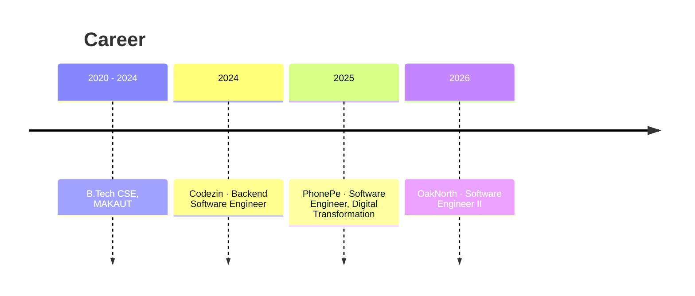

<h1>Bishal Chakraborty</h1>

  

---

### 👨‍💻 About

Software Engineer II at **OakNorth**, working on a production multi-agent document-intelligence platform (LangGraph · Claude · MCP · PostgreSQL). Previously at **PhonePe** and **Codezin**. I care about system design, event-driven architecture, and shipping things that hold up under real load.

🔭 Currently building event-driven pipelines and agentic AI services — in public, from scratch.
🌱 Open to backend / AI engineering roles.

---

### 🗺️ Career

---

### 🛠 Tech

**Backend:** FastAPI · Django · async · REST · WebSockets
**AI / Agents:** LangGraph · Claude API · MCP tool calling · RAG · Pydantic
**Data:** PostgreSQL · Redis · BigQuery · Elasticsearch
**Cloud / Infra:** AWS (S3, SNS/SQS, Lambda) · GCP · Docker · GitHub Actions CI/CD

---

### 🚀 What I'm building

**[salary-pipeline](https://github.com/satyanweshi11/salary-pipeline)** — an event-driven file ingestion pipeline, built end to end.
- Magic-byte validation → pre-signed S3 uploads → S3 · SNS · SQS → async worker → PostgreSQL (JSONB). FastAPI throughout, LocalStack for AWS in dev.
- **Roadmap:** three AI engines on top of the pipeline — **Predict** (ML on the ingested data), **Know** (RAG over the documents), and **Act** (agents that take actions).

**[developer-voice-agent](https://github.com/satyanweshi11/developer-voice-agent)** *(Frequency AI)* — an agentic voice assistant, built in phases.
- **Phase 1 (shipped):** a hardened real-time **WebSocket** service — concurrency-safe connection manager, resilient broadcast that prunes dead connections, origin allowlisting (CSWSH defense), sliding-window rate limiting, and client auto-reconnect with exponential backoff + jitter. Tested, with CI gating merges.
- **Roadmap:** **Claude streaming** over the socket → **voice** (speech-to-text in, text-to-speech out) → a **telephony / IVR** layer, with human-in-the-loop checkpoints throughout.

---

### 📊 Stats

